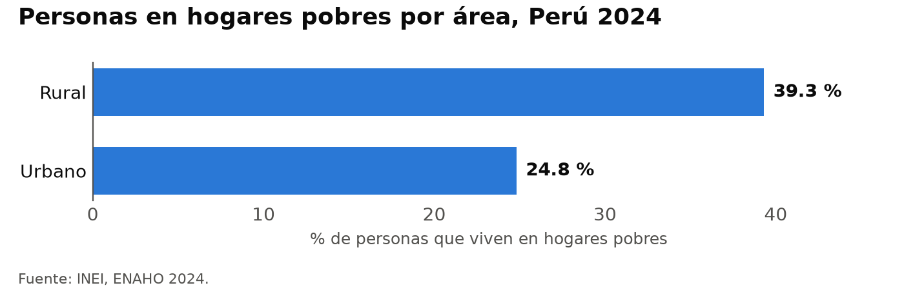

# skills-enaho

Skills de Claude Code para trabajar con la ENAHO del INEI de forma reproducible. Cualquiera que clone el repositorio obtiene la misma base, con la pobreza oficial replicada.

| Skill | Qué hace | Estado |
|---|---|---|
| [`descargando-enaho`](.claude/skills/descargando-enaho/SKILL.md) | Baja los módulos 34 y 02 del INEI y decide qué archivo usar, incluida la sumaria | ✅ |
| [`limpiando-enaho`](.claude/skills/limpiando-enaho/SKILL.md) | Une los módulos 34 y 02 en una base de personas y la valida contra el INEI | ✅ |
| [`graficando-enaho`](.claude/skills/graficando-enaho/SKILL.md) | Grafica el % de personas que viven en hogares pobres por área, sexo o edad, siempre con las mismas reglas | ✅ |

## Requisitos

- [Claude Code](https://claude.com/claude-code)
- [uv](https://docs.astral.sh/uv/)

## Datos

Los microdatos no se suben al repositorio. Pídele a Claude «descarga la ENAHO 2024», o corre:

```bash
uv run .claude/skills/descargando-enaho/scripts/descargar.py --anio 2024
```

Esto baja `966-Modulo34.zip` y `966-Modulo02.zip` a `datos/`. 966 es el código de la ENAHO 2024 en el portal de microdatos del INEI. No hace falta descomprimirlos.

**Qué sumaria se usa:** `sumaria-2024.dta`, con el gasto en 8 grupos. El repositorio no usa la `-12g`: da la misma pobreza, pero desglosa el gasto en 12 grupos con variables que se llaman igual y miden otra cosa. Detalle en [reference.md](.claude/skills/descargando-enaho/reference.md).

## Uso

Con Claude Code, en la raíz del repositorio:

```
/limpiando-enaho 2024
¿Cuál fue la pobreza en Cusco en 2024?
```

La skill también se activa sola cuando pides algo sobre la ENAHO o la pobreza.

Para limpiar sin Claude:

```bash
uv run .claude/skills/limpiando-enaho/scripts/limpiar.py --anio 2024
```

Esto genera:

- `salidas/personas_2024.parquet`: 109,842 miembros del hogar según el INEI, con la pobreza de su hogar y los factores de expansión
- `salidas/validacion.txt`: los chequeos. Si alguno falla, el script termina con error y no guarda la base

Para graficar sin Claude:

```bash
uv run .claude/skills/graficando-enaho/scripts/graficar.py --por area   # o sexo, edad
```

Genera `figuras/pobreza_por_<corte>_2024.png`, ponderado con `facpob07`.



## Validación (ENAHO 2024)

| Chequeo | Resultado | INEI |
|---|---|---|
| Pobreza monetaria | 27.58 % | 27.6 % |
| Pobreza extrema | 5.50 % | 5.5 % |
| Miembros del hogar | 109,842 | Suma de `mieperho` |
| Miembros por hogar iguales a `mieperho` | 33,691 de 33,691 hogares | — |
| Llaves únicas, unión sin perder ni duplicar filas | OK | — |

## Método

Se sigue el método del INEI. La base de personas incluye a todos los miembros del hogar (`p204 = 1`), presentes o ausentes: son las mismas personas entre las que el INEI reparte el gasto del hogar para decidir si es pobre. Por eso la base de personas ponderada con `facpob07` da exactamente lo mismo que la sumaria ponderada con `factor07 × mieperho`.

Este método difiere de las diapositivas del curso, que filtran residentes habituales (108,664 personas, 27.53 %). Ese filtro deja fuera a miembros ausentes que el INEI sí cuenta.

**Factor de expansión:** los gráficos y los mapas usan `facpob07` (factor de personas), porque es el que permite desagregar por sexo y edad. Con el método del INEI equivale a `factor07 × mieperho` de la sumaria. Las figuras llevan al pie solo la fuente.

**Terminología:** la pobreza monetaria es del hogar, y todos sus miembros comparten la condición. Por sexo o edad se dice "X % de las mujeres vive en hogares pobres", nunca "las mujeres son más pobres".

Fuente: INEI, ENAHO 2024, módulos 34 y 02.
