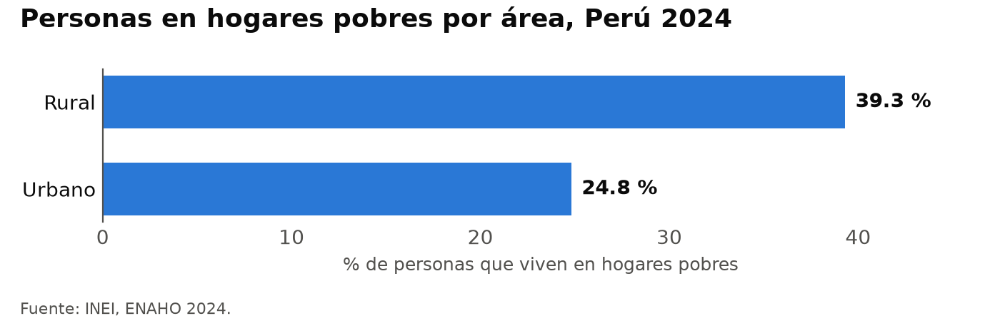
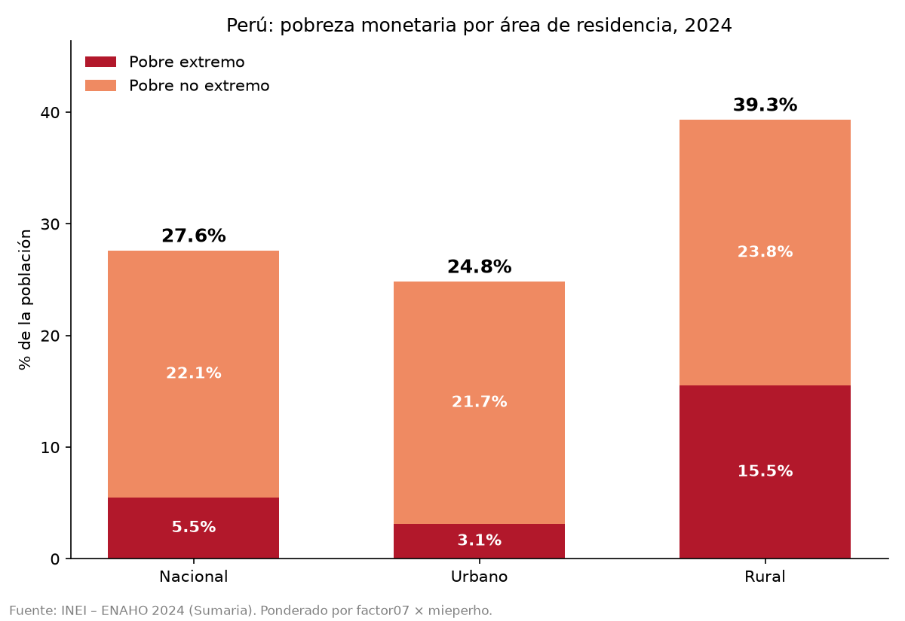
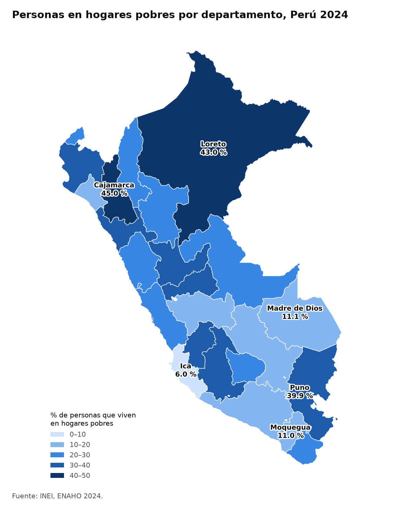
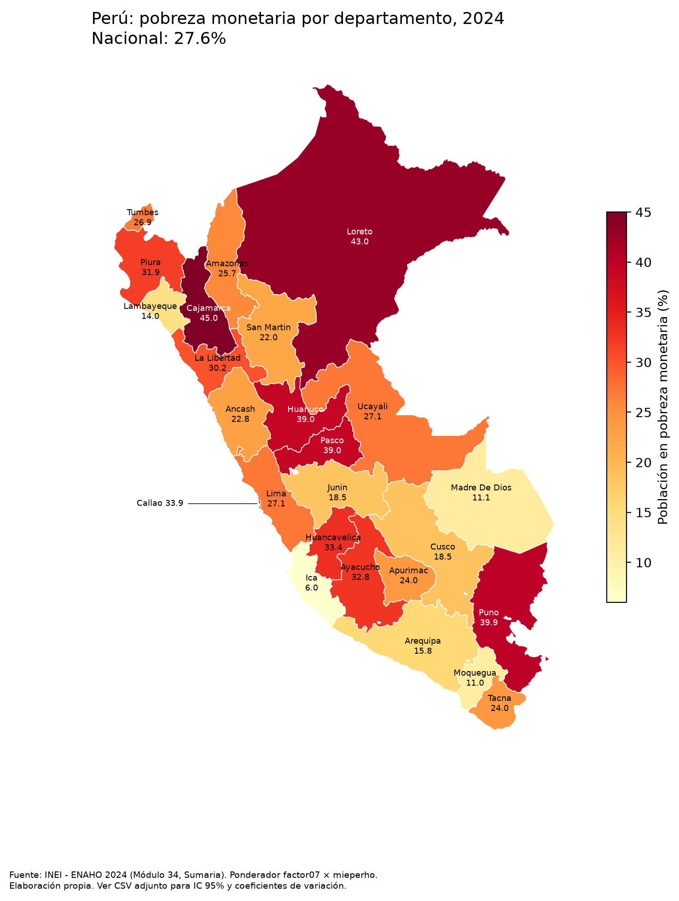

# Evaluación: con y sin skills

Tres pedidos, cada uno corrido una vez con las skills y una vez sin ellas, con `claude -p` (Claude Code 2.1.316), el 31 de octubre de 2026.

## Resultados

| Pedido | Con skills | Sin skills |
|---|---|---|
| **¿Cuál fue la pobreza en Cusco en 2024?** | Activó `limpiando-enaho`. **18.5 %** ✅, ponderado con `facpob07`. Respondió "el 18.5 % de las personas en Cusco vivía en hogares pobres". | **No dio cifra.** No revisó los datos de la carpeta: intentó buscar en internet, no tenía permiso y respondió que no recordaba el dato. |
| **Grafica la pobreza urbana y rural** | Activó `graficando-enaho` y, como no había base limpia, antes `limpiando-enaho`. **24.8 % y 39.3 %** ✅. Gráfico con las reglas fijas. | **24.8 % y 39.3 %** ✅, ponderado con `factor07 × mieperho` de la sumaria. Barras apiladas en rojo y naranja. Nombre y carpeta del archivo inventados. Descomprimió los zip, una vez fuera de su carpeta de trabajo. |
| **Haz un mapa de la pobreza por departamento con la ENAHO 2024** | Activó `mapeando-enaho` y, antes, `limpiando-enaho`. **Cajamarca 45.0 %, Ica 6.0 %** ✅. Los 25 departamentos con dato, unidos por código. | **Cajamarca 45.0 %, Ica 6.0 %** ✅, unido por código. Escala amarillo-rojo de 6 % a 45 %, que no empieza en 0. Los 25 departamentos rotulados. Agregó intervalos de confianza en un CSV. |

| | Con skills | Sin skills |
|---|---|---|
| Costo del gráfico | USD 0.16 (9 turnos) | USD 0.28 (9 turnos) |
| Costo del mapa | USD 0.21 (9 turnos) | USD 0.42 (12 turnos) |
| Costo del pedido de Cusco | USD 0.17 (7 turnos) | USD 0.17 (4 turnos), sin respuesta |

## Figuras

| | Con skills | Sin skills |
|---|---|---|
| Urbano y rural |  |  |
| Departamentos |  |  |

## Conclusiones

- **Las skills hacen que Claude encuentre y use los datos.** Ante «¿Cuál fue la pobreza en Cusco?», sin skills Claude no revisó la carpeta y no dio cifra. Con skills, la description de `limpiando-enaho` se activó y la respuesta fue la correcta.
- **El encadenamiento funciona.** En los pedidos de gráfico y de mapa no existía la base limpia, y Claude activó primero `limpiando-enaho` sin que se lo pidieran.
- **Mismo resultado, menor costo.** Con skills, cada corrida produce los mismos archivos, el mismo diseño y la misma terminología («personas que viven en hogares pobres»). Sin skills, cada corrida inventa nombres, carpetas y estilos. El gráfico y el mapa costaron cerca de la mitad con skills.
- **Las cifras no dependen de las skills.** Sin skills, Claude calculó bien la pobreza urbana, rural y departamental. El aporte de las skills no es la exactitud de estos números, sino la consistencia, las reglas de diseño (un solo color, escala desde 0) y el método fijo.
- **Algo que la skill de mapas podría aprender:** sin skills, Claude agregó intervalos de confianza por departamento. Nuestras skills no reportan margen de error.

## Cómo se corrió

```bash
claude -p "<pedido>" --output-format stream-json --verbose --no-session-persistence --strict-mcp-config \
  --allowedTools "Bash(uv run:*)" "Bash(ls:*)" "Bash(cd:*)" "Bash(.venv/bin/python:*)" "Bash(python3:*)" \
    "Bash(python:*)" "Bash(unzip:*)" "Bash(cat:*)" "Bash(head:*)" "Bash(find:*)" "Bash(mkdir:*)" \
    Read Write Edit Glob Grep
# sin skills: lo mismo, más --disallowedTools Skill
```

- **Una copia limpia por corrida**, con `datos/` (los dos zip y el GeoJSON), `pyproject.toml` y `uv.lock`, pero sin `salidas/`, `figuras/` ni `mapas/`. Así se prueba que encadenen la limpieza.
- **Sin README en ninguna copia**, porque explica el método y daría pistas.
- **Las corridas sin skills no llevan `.claude/`**, para que Claude no pueda leer los scripts de las skills por su cuenta.
- **Sin conectores ni búsqueda web**, en las dos versiones.

## Limitaciones

- Cada pedido se corrió una sola vez. Otra corrida podría dar un resultado algo distinto, sobre todo sin skills.
- Sin internet, el pedido de Cusco sin skills no pudo buscar la cifra en la web. Con internet habría podido encontrar el dato publicado, aunque sin calcularlo.
- Un primer intento se descartó porque los permisos solo dejaban correr `uv run` y `ls`. Las corridas sin skills no podían ejecutar Python, así que la comparación no era justa.
